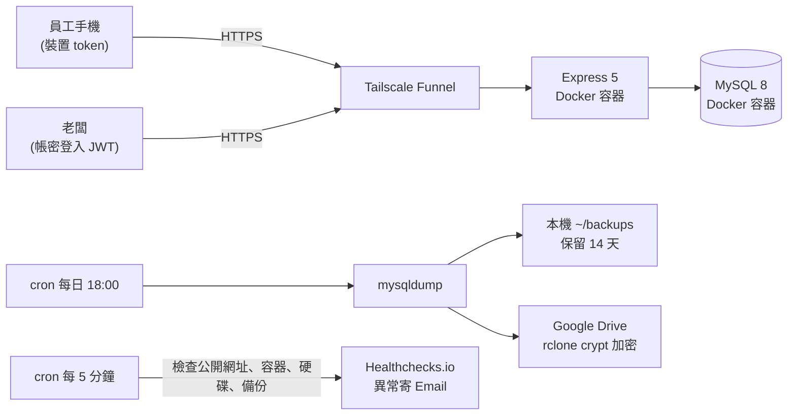

# 🥟 車庫小籠包 員工打卡與薪資系統

為真實營運中的餐飲小店（車庫小籠包・三芝店）打造的員工出勤、休假與薪資結算系統。員工用**自己的手機**打卡，老闆用手機或電腦管理；跑在一台舊筆電上，以 Docker 部署，對外只透過 Tailscale Funnel 的 HTTPS 提供服務。


> 這不是展示用的玩具專案：它在店裡實際使用，所以許多設計（防代打卡、定位驗證、備份、監控）都是為了解決**真實會遇到的問題**。完整的演進與取捨見 [優化歷程](#-優化歷程) 與 [設計決策](#-設計決策與取捨)。

## 目錄

- [功能](#-功能)
- [系統架構](#-系統架構)
- [優化歷程](#-優化歷程)
- [設計決策與取捨](#-設計決策與取捨)
- [技術棧](#-技術棧)
- [快速啟動](#-快速啟動)
- [正式環境部署](#-正式環境部署)
- [測試](#-測試)
- [API](#-api)
- [資料模型](#-資料模型)
- [專案結構](#-專案結構)
- [已知限制](#-已知限制)

---

## ✨ 功能

### 員工（只用手機，不需帳號密碼）

- **手機綁定員工**：老闆在後台為「某一位員工」產生專屬 QR Code，員工掃描後，**這支手機從此只屬於他**，只能替他自己打卡。打開網頁直接是自己的打卡畫面，**沒有名單可選，無法代打**。換手機時重新產生，舊手機自動失效。
- **一次性登記碼**：QR Code 預設 10 分鐘有效、只能用一次；通行碼放在網址的 `#` 之後（瀏覽器不會送到伺服器），掃描後立即從網址列清除。被拍照也無法再使用。
- **定位驗證（只能在店裡打卡）**：老闆在店裡按一次「把我現在的位置設為店的位置」，之後員工打卡時手機回報位置，離店過遠、定位不準、未允許定位都無法打卡；每筆打卡記錄離店距離供事後查核。
- **打卡**：上班／下班，支援「正常」「加班」兩種班別。同日同班別不可重複、未打上班卡不可打下班卡；**加班需先完成當天正常班**（後端強制檢查，畫面同步鎖定按鈕防誤按）。
- **個人頁面**：問候語、今天狀態、本月統計（出勤天數／工時／休假天數，**不顯示薪資**）、最近 14 天紀錄。

### 老闆（後台）

- **首頁概況**：在職員工、今日已打卡、上班中、尚未打卡（並列出名字）；可選任一日期查詢當天出勤。
- **員工管理**：新增（員工只需姓名與時薪）、修改時薪、**離職**（保留歷史、可復職）、**刪除**（連同紀錄永久刪除；有紀錄的人須先標記離職，且不能刪除自己）。管理員可自行決定是否也要打卡。
- **員工手機與位置**：為員工產生登記 QR Code（可用 LINE 傳連結）、查看與解除各員工手機、設定店的位置與允許範圍。
- **補打卡**：替員工補登、修改、刪除出勤紀錄（不可補未來時間、下班需晚於上班），補登紀錄會標記並可附備註。
- **休假**：整天沒有任何打卡紀錄的日子**自動列為休假**（只算到昨天、到職日之後、在職員工），顯示於員工紀錄、薪資與當日查詢。
- **薪資核算**：依月份彙整每位員工工時、休假天數與薪資，附每日明細，並可**匯出 Excel（CSV）**。一律按「工時 × 時薪」計算，加班與正常班相同，不另加成（可依需求調整）。

### 其他

- 請假申請與審核、排班（後端 API 完整，目前沒有前端畫面）。
- 外部健康監控與自動備份（見 [正式環境部署](#-正式環境部署)）。

---

## 🏗 系統架構



**兩種身分、兩套驗證，互不通用：**

| | 老闆 | 員工手機 |
| :--- | :--- | :--- |
| 取得方式 | 帳號密碼登入 | 掃一次性 QR Code 登記 |
| Token | JWT（含使用者 id，預設 1 天） | JWT（含 `kiosk` 與裝置 id，1 年） |
| 每次請求的檢查 | 使用者仍存在 | **裝置仍存在**、所屬員工在職且需要打卡 |
| 能做什麼 | 全部後台功能 | 只能查自己的紀錄、替自己打卡 |

裝置 token 的有效性**在資料庫裡判斷**（`Device` 表），所以老闆可以隨時「解除某支手機」立即生效，不必等 token 過期。

---

## 🚀 優化歷程

這個專案從「能打卡的後端」逐步演進成「可以放心交給店裡用的系統」。依主題整理如下（每一項都有對應的 commit 與測試）。

### 1. 架構與工程品質

| 之前 | 之後 |
| :--- | :--- |
| 單純的 API | routes / controllers / middlewares / services / validations 分層；打卡邏輯抽成 `punchService`，登入者與員工手機**共用同一套規則** |
| 手寫 SQL／直接存取 | Prisma ORM（型別安全、`db push` 自動同步資料表） |
| 輸入驗證分散 | Zod 在入口統一驗證，錯誤回傳欄位級訊息 |
| 無自動測試 | Jest + Supertest，**117 個測試**，GitHub Actions 起 MySQL 服務執行 |

### 2. 安全強化

- **沒有預設密碼**：`seed` 必須提供 `ADMIN_PASSWORD`；員工帳號由系統產生**隨機、無人知道的密碼**（員工根本不用登入）。
- **正式環境關閉 `/api-docs`**；MySQL 與後端只綁定 `127.0.0.1`，對外唯一入口是 Funnel。
- **helmet 嚴格 CSP**（`script-src 'self'`）：前端完全不使用 inline script／事件，所有 JS 都是外部檔案。
- **限流**：登入 15 分鐘 5 次、登記 15 分鐘 10 次、打卡每分鐘 60 次；設定 `trust proxy` 才能在反向代理後取得**真實 IP**（否則所有人共用同一個額度）。
- **修正 JWT 錯誤處理**：過期／無效 token 原本會變成 500，現在正確回 401，前端才能導回登入。
- **權限隔離經測試驗證**：員工手機 token 無法呼叫任何後台 API；後台 token 也無法當作手機 token。

### 3. 防止代打卡與假打卡（最重要的演進）

這部分的設計是「發現漏洞 → 修補 → 再發現下一個」的過程：

```
V1  員工用帳號密碼登入打卡              → 太麻煩，員工會共用帳密
V2  公開網址 + 選名字打卡               → 任何人知道網址就能亂打卡、看到全部員工名字
V3  加一道「店內通行碼 QR Code」          → 通行碼長期有效，被拍照轉傳就失效
V4  QR Code 改成一次性（時效 + 次數上限）  → 拍照沒用了；但同店員工仍可選別人的名字代打
V5  手機綁定員工（專屬 QR Code）          → 一支手機只能替自己打卡，沒有名單、無法代打
V6  定位驗證                            → 人不在店裡也無法打卡
```

過程中補的細節：以**單一條件式 UPDATE 搶佔名額**，多支手機同時掃同一組碼也不會超過上限（有並行測試）；換手機時舊手機自動失效；員工離職後手機立即不能打卡；每筆打卡記錄離店距離供事後查核。

### 4. 資料完整性

- **「離職」與「刪除」分開**：離職保留歷史紀錄；刪除會連帶刪掉紀錄，所以有紀錄的人**不能直接刪**，且刪除前會顯示將消失的筆數並二次確認。
- **休假是「計算出來的」而非儲存**：整天沒紀錄即休假，補打卡或刪除紀錄後自然隨之更新，不會有「資料不同步」的問題；並排除到職日之前、今天（尚未結束）與離職員工。
- **補登與修改留痕**：`manual` 標記與備註，薪資明細與員工頁面都看得到。
- **時間一律以 `Asia/Taipei` 計算**，與伺服器時區無關。
- **「需要打卡」獨立成欄位**（`punch`）：所有名單、統計、休假計算都依它判斷，而不是只看身分，管理員因此可以選擇要不要打卡。

### 5. 維運與可靠度

- **Docker**：`restart: unless-stopped`，開機自動啟動；容器啟動時自動 `prisma db push`。
- **每日自動備份**：`mysqldump` → 本機保留 14 天 + `rclone crypt` 加密上傳 Google Drive（雲端只看得到亂碼，只授權 `drive.file` 最小範圍）。
- **外部健康監控**：筆電每 5 分鐘從**公開網址**檢查整條路徑（網路 → Funnel → 系統 → 資料庫）、容器、硬碟空間、備份是否過期，向 Healthchecks.io 報平安；異常立刻通知，**連報平安都失敗（當機、斷電、斷網）也會通知**。
- **`GET /api/health`**：確認網站與資料庫，不需登入、不回傳資料。
- **停用金鑰到期**（Tailscale 預設 180 天後會把機器踢出，導致網站突然打不開）、關閉睡眠與闔蓋休眠、時區設為台北。

### 6. 前端與使用體驗

- **手機優先、淺色簡潔**：員工多在店裡單手、強光下使用。大按鈕（可點元素皆 ≥ 44px）、高對比、`viewport-fit` 與安全區域支援。
- **紀錄改為清單**（不用表格）：四欄表格在窄螢幕會被迫橫向捲動。以 **320 / 360 / 390 寬**實測無橫向溢出。
- **防誤按**：打卡後按鈕依當天紀錄自動鎖定；送出期間鎖住防連點；結果留在畫面上而不是 3 秒就消失。
- **品牌化**：店標、紅色橫幅、依時段的問候語。
- **處理真實會遇到的坑**：
  - 從 LINE 點連結會進**內建瀏覽器**（儲存空間與手機瀏覽器分開）→ 分享連結帶 `openExternalBrowser=1`，並在內建瀏覽器偵測時提示。
  - 已登記的手機再點一次用過的登記連結 → 直接進打卡畫面，不顯示錯誤。
  - 同一瀏覽器同時有老闆登入與手機登記 → 提供互相切換。
  - 加到主畫面的圖示：`manifest.webmanifest` 刻意設定 `display: browser`（而非 `standalone`）。iPhone 的「獨立 App 模式」儲存空間與 Safari 是分開的，會讓已登記的手機記號消失；維持一般瀏覽器模式只換圖示，登記狀態才不會掉。

### 7. 效能、資源與程式碼衛生

最後一輪盤點，逐項**量測**後再修：

| 項目 | 之前 | 之後 |
| :--- | :--- | :--- |
| **套件漏洞**（`npm audit`，正式相依） | 13 個（1 嚴重、5 高、7 中） | **0 個**（升級至修正版；移除其實沒在使用的 `swagger-jsdoc`） |
| **重複打卡** | 只靠程式「先查再寫」，同時送出多個請求理論上可能寫入多筆 | 資料庫**唯一限制**（人＋日期＋班別），並行測試驗證：8 個同時請求只成功 1 個 |
| **查詢速度** | 出勤、薪資依日期範圍查詢卻沒有索引 | 加上日期索引，資料累積後仍能維持速度 |
| **資料庫連線** | 11 個檔案各自建立 `PrismaClient`（各一組連線池） | 共用單一實例，並在收到停止訊號時正常關閉連線 |
| **傳輸大小** | 沒有壓縮 | gzip：`app.js` 21 KB → 6.4 KB、`style.css` 17.8 KB → 4.3 KB（行動網路更快） |
| **日誌** | 預期內的錯誤（重複打卡、驗證失敗）也記成 error 並附堆疊；日誌存在容器內，重新部署就消失 | 預期內的 4xx 只記一行 warn，5xx 才記 error；日誌寫入磁碟 volume |
| **Docker 映像** | 707 MB、包含 jest 等測試套件、以 root 執行 | **多階段建置**：593 MB、不含測試套件、以非 root 使用者執行；測試用映像獨立 |
| **服務狀態** | 只知道「容器有沒有在跑」 | 容器內建健康檢查（`docker ps` 直接顯示 healthy／unhealthy） |
| **備份指令** | 資料庫密碼放在命令列參數 | 改用環境變數 |
| **無用的程式** | AI 辨識假功能、只剩測試在用的舊端點 | 移除，縮小攻擊面 |

另外做了**備份還原演練**：建立測試資料 → 備份 → 分別從「本機備份」與「Google Drive 加密備份（下載並解密）」還原到暫時資料庫 → 資料完整，且兩份檔案內容完全一致。

### 8. 測試策略

- **117 個測試**涵蓋：打卡規則與並行重複打卡、加班前置、休假計算、**薪資金額**（四捨五入、加班不加成、未下班與跨月不計、**調整時薪不影響過去月份**）、CSV 匯出、補打卡、一次性登記碼（時效、次數、並行搶名額）、手機只能替自己打卡、換手機／解除／停用、定位驗證（過遠、不準、未開定位）、員工刪除保護、健康檢查。
- **只在獨立資料庫執行**：`scripts/test.sh` 會建立暫時資料庫、以測試用映像執行、結束後自動刪除，絕不碰正式資料。
- 前端以**實際執行頁面的 JavaScript**（jsdom）驗證各身分的畫面，而不是只看伺服器回 200：曾因移除一個畫面元素卻漏改程式導致整頁空白，這類錯誤只有真的執行頁面才抓得到。

---

## 🧭 設計決策與取捨

| 決策 | 原因／取捨 |
| :--- | :--- |
| **員工不需要帳號密碼** | 店員流動快、多半不熟技術，密碼只會被共用。改以「一次性 QR Code 綁定手機」取代，管理成本更低、也更難代打 |
| **用 Tailscale Funnel 對外** | 店家是中華電信家用線路，無法設定數據機的 Port Forwarding，也沒有固定 IP 或網域。Funnel 免費、有固定網址與自動 HTTPS、不必開任何 port，反而比開 Port 更安全 |
| **定位用手機 GPS，不用店內 Wi-Fi** | 店裡沒有 Wi-Fi，員工用行動網路。代價：無法防範刻意使用虛擬定位的人，所以每筆都記錄距離供事後查核 |
| **QR Code 一次性 + 綁定員工** | 長期有效的 QR Code 一旦被拍照就失效；「選名字」無法防止同店員工互相代打 |
| **休假用計算而非儲存** | 避免與打卡紀錄不同步；補打卡與刪除紀錄自然正確 |
| **加班不加成** | 依店家決定。程式中薪資計算集中在 `salaryController`，要改成加成倍率只需改一處（台灣勞基法對延長工時有加給規定，使用前請自行確認） |
| **單台機器部署** | 成本最低、符合小店規模；代價是單點故障，所以用外部監控、自動備份與補打卡機制降低風險 |
| **原生 HTML/CSS/JS，不用前端框架** | 頁面少、需要極快載入與嚴格 CSP；省去建置流程，維護者只需看懂一般 JS |

---

## 🛠️ 技術棧

| 類別 | 使用 |
| :--- | :--- |
| 後端 | Node.js 20、Express 5（routes / controllers / middlewares / services 分層） |
| 資料庫 | MySQL 8 + Prisma ORM 5 |
| 安全 | JWT、bcrypt、helmet（CSP）、cors、express-rate-limit |
| 驗證 | Zod |
| 日誌 | Winston（含每日輪替檔案） |
| 其他套件 | dayjs（時區）、qrcode-generator（伺服器端產生 QR Code，無相依套件） |
| 測試 / CI | Jest + Supertest、GitHub Actions（含 MySQL service） |
| 部署 | Docker / Docker Compose、Tailscale Funnel |
| 備份 / 監控 | mysqldump + rclone（crypt）、cron、Healthchecks.io |
| 前端 | 原生 HTML / CSS / JS，淺色簡潔、手機優先 |

---

## 🚀 快速啟動

需要 Docker 與 Docker Compose。

```bash
cp .env.example .env     # 修改 MYSQL_ROOT_PASS 與 JWT_SECRET（請用長的隨機字串）
```

### 方式一：Docker 一鍵啟動

```bash
docker compose up -d --build
```

容器啟動時會自動建立資料表。第一次使用請建立管理員帳號：

```bash
docker compose exec -e ADMIN_PASSWORD='你的密碼' punch_backend node prisma/seed.js
```

服務位於 `http://localhost:3001`（只綁定本機）。登入後到「員工管理」新增員工、到「員工手機」頁登記手機。

### 方式二：本機開發

```bash
docker compose up -d punch_db      # 只啟動資料庫（對外 port 為 DB_PORT_EXTERNAL，預設 3311）
npm install
npx prisma db push                 # 建立資料表並產生 Prisma Client
ADMIN_PASSWORD='你的密碼' npm run seed
npm run dev                        # http://localhost:3001
```

> **關於資料表結構的更新**：容器啟動時會執行 `prisma db push`，**不帶** `--accept-data-loss`。因此當結構變更可能影響既有資料（例如新增唯一限制），Prisma 會拒絕並讓容器啟動失敗，這是刻意的保護：請先確認資料沒有問題，再手動套用該變更。

### 環境變數

| 變數 | 說明 |
| :--- | :--- |
| `MYSQL_ROOT_PASS` / `MYSQL_DB_NAME` | 資料庫密碼與名稱 |
| `JWT_SECRET` | JWT 簽章密鑰（務必使用長隨機字串） |
| `JWT_EXPIRES_IN` | 老闆登入有效期，預設 `1d` |
| `SYSTEM_TZ` | 容器時區，預設 `Asia/Taipei` |
| `DATABASE_URL` | 本機執行（`npm start`、`prisma`、`npm test`）使用，port 需與 `DB_PORT_EXTERNAL` 一致 |
| `ENABLE_API_DOCS` | 正式環境預設不開放 `/api-docs`，設為 `true` 才開 |
| `PAIR_RATE_LIMIT_MAX` | 手機登記的限流上限（每 15 分鐘），預設 10 |

> 專案不含任何預設密碼。`.env` 已列入 `.gitignore`，請勿提交。

---

## 🌐 正式環境部署

目前的實際部署方式（一台舊筆電 + 家用網路），供參考：

### 1. 對外連線（Tailscale Funnel）

```bash
curl -fsSL https://tailscale.com/install.sh | sh
sudo tailscale up                       # 依提示登入
sudo tailscale funnel --bg 3001         # 把本機 3001 公開成 HTTPS 網址
```

在 Tailscale 管理後台啟用 **HTTPS Certificates**，並對這台機器**停用金鑰到期**（Disable key expiry），否則 180 天後會被踢出、網站突然打不開。

### 2. 讓筆電當伺服器

- 關閉睡眠與闔蓋休眠：`HandleLidSwitch=ignore`，並 `systemctl mask sleep.target suspend.target hibernate.target`。
- 關閉 Wi-Fi 省電模式，或改用網路線。
- 時區設為 `Asia/Taipei`；BIOS 開啟「來電自動開機」。

### 3. 每日備份

`scripts/backup.sh` 會把資料庫匯出、壓縮，存到 `~/backups`（保留 14 天），若已設定 rclone 遠端 `gdrive-crypt` 則一併加密上傳。

```bash
# cron：每天 18:00（店家下班之後）
0 18 * * * /path/to/scripts/backup.sh >> ~/backups/backup.log 2>&1
```

雲端加密建議使用 rclone 的 `crypt`，並只授權 `drive.file`（最小權限）。**請妥善保存 rclone 設定檔，加密密碼遺失就無法還原雲端備份。**

還原備份（已實際演練過，建議定期再做）：

```bash
gunzip -c ~/backups/punch_db_XXXX.sql.gz | docker exec -i punch_mysql sh -c 'mysql -uroot -p"$MYSQL_ROOT_PASSWORD" punch_db'
```

### 4. 健康監控

在 [Healthchecks.io](https://healthchecks.io) 建立一個 Check（Period 5 分鐘、Grace 10 分鐘），把 Ping 網址寫進 `~/.healthcheck_url`（權限 600、不進 git），再排程：

```bash
*/5 * * * * /path/to/scripts/healthcheck.sh >> ~/backups/healthcheck.log 2>&1
```

腳本會檢查公開網址的 `/api/health`、容器是否執行、硬碟用量、備份是否超過 30 小時；正常報平安、異常立即回報失敗並附原因。

### 5. 上線前清單

1. 在店裡設定**店的位置**（未設定前不限制位置）。
2. 為每位員工產生專屬 QR Code 並完成登記，現場測試打卡。
3. 清除測試用的打卡紀錄。
4. 準備斷網／停電時的紙本備案，事後用「補打卡」補上。

---

## 🧪 測試

測試會**清空所連線資料庫的資料表**，所以請一律使用腳本，它會在 MySQL 容器裡建立暫時資料庫（`punch_test`）、以獨立的測試映像執行，結束後自動刪除，**不會碰到正式資料**：

```bash
scripts/test.sh
```

> 不使用 Docker 時，也可自行指向獨立資料庫：
> `DATABASE_URL="mysql://root:<密碼>@localhost:3311/punch_test" JWT_SECRET=test npx prisma db push && npm test`（請務必確認不是正式資料庫）

測試設定為依序執行（`--runInBand`），共 **117 個**：

| 檔案 | 數量 | 涵蓋 |
| :--- | :---: | :--- |
| `tests/kiosk.test.js` | 50 | 一次性登記碼（時效、次數、並行搶名額）、手機只能替自己打卡、換手機／解除／停用、定位驗證、管理員也打卡、員工刪除保護 |
| `tests/records.test.js` | 20 | 補打卡的權限、驗證、新增／修改／刪除與休假連動、並行補登 |
| `tests/attendance.test.js` | 15 | 基本打卡流程、加班前置、下班需有上班、並行重複打卡、資料庫唯一限制、健康檢查 |
| `tests/dayoff.test.js` | 13 | 休假計算（到職日、今天、離職）、薪資休假天數、指定日期查詢 |
| `tests/salary.test.js` | 13 | 薪資金額：四捨五入、加班不加成、未下班與跨月不計、補登標記、時薪 0；調整時薪不影響過去月份、月中調薪依日期套用、重複儲存不產生多餘紀錄、刪除員工連動刪除時薪歷史 |
| `tests/csv.test.js` | 6 | Excel 匯出（BOM、跳脫、防止試算表公式注入） |

---

## 📡 API

共 30 多個端點。互動式文件：`/api-docs`（正式環境預設關閉；目前僅涵蓋部分端點）。

| 分類 | 方法 | 路由 | 說明 | 權限 |
| :--- | :--- | :--- | :--- | :--- |
| 健康 | GET | `/api/health` | 網站與資料庫狀態 | 公開 |
| 驗證 | POST | `/api/auth/login` | 登入取得 Token | 公開（限流） |
| 員工 | GET / POST | `/api/employees` | 列表（含打卡筆數）/ 新增 | ADMIN |
| 員工 | PUT / DELETE | `/api/employees/:id` | 修改（姓名、時薪、`active`、`punch`）/ 刪除 | ADMIN |
| 出勤 | GET | `/api/attendance/today` | 今日出勤 | ADMIN |
| 出勤 | GET | `/api/attendance/day?date=` | 指定日期的出勤與未打卡名單 | ADMIN |
| 出勤 | GET | `/api/attendance/my-records` | 登入者最近 14 天紀錄與本月統計 | 登入者 |
| 打卡 | POST | `/api/clock` | 登入者打卡（`type`、`punch_type`） | 登入者 |
| 補打卡 | GET / POST | `/api/records` | 某員工某月紀錄（含休假日）/ 補登 | ADMIN |
| 補打卡 | PUT / DELETE | `/api/records/:id` | 修改 / 刪除一筆紀錄 | ADMIN |
| 薪資 | GET | `/api/salary?month=YYYY-MM` | 月薪資彙總與每日明細 | ADMIN |
| 手機 | POST | `/api/kiosk/pair` | 以專屬 QR Code 通行碼綁定手機、取得裝置 token | 公開（限流） |
| 手機 | GET | `/api/kiosk/me`、`/api/kiosk/records` | 這支手機的主人／其最近紀錄 | 裝置 token |
| 手機 | POST | `/api/kiosk/clock` | 替綁定的員工打卡（`type`、`punch_type`、`location`） | 裝置 token |
| 登記 | GET / POST | `/api/kiosk/qr` | 目前有效的登記 QR Code / 為某員工產生 | ADMIN |
| 登記 | GET | `/api/kiosk/devices` | 各員工手機登記狀態 | ADMIN |
| 登記 | DELETE | `/api/kiosk/devices/:userId` | 解除某員工的手機 | ADMIN |
| 登記 | POST | `/api/kiosk/revoke-all` | 讓所有員工手機失效 | ADMIN |
| 位置 | GET / PUT / DELETE | `/api/kiosk/location` | 店的位置與允許範圍 | ADMIN |
| 請假 | POST / GET | `/api/leaves` | 送出申請 / 所有請假單 | 登入者 / ADMIN |
| 請假 | PUT | `/api/leaves/:id/status` | 審核 | ADMIN |
| 排班 | GET / POST | `/api/shifts` | 檢視 / 新增 | 登入者 / ADMIN |

---

## 🗄 資料模型

| 資料表 | 用途 |
| :--- | :--- |
| `User` | 員工與管理員；`role`、`hourly_rate`、`active`（在職）、`punch`（是否需要打卡） |
| `RateHistory` | 時薪調整歷史：每筆打卡依「打卡日期」套用當時的時薪，調整時薪不會改變過去月份的薪資 |
| `Attendance` | 打卡紀錄：日期、班別、上下班時間、`manual`（補登）、`note`、`in_distance` / `out_distance`（離店距離） |
| `Device` | 已登記的員工手機（一位員工一支），刪除員工時連動刪除 |
| `PairingCode` | 一次性登記碼：綁定某員工、有效期限、次數上限 |
| `Setting` | 店的位置與允許範圍等設定 |
| `Leave` / `Shift` | 請假單 / 排班 |

---

## 📁 專案結構

```
src/
  app.js / server.js        Express 組裝與啟動
  routes/                   路由（auth、employees、attendance、records、kiosk、salary、leaves、shifts、health）
  controllers/              業務邏輯
  services/punchService.js  打卡核心規則與休假計算（登入者與員工手機共用）
  middlewares/              JWT / 裝置驗證、角色限制、Zod 驗證、錯誤處理
  validations/              Zod schema
  config/swagger.js         OpenAPI 文件
  utils/                    logger、catchAsync、prisma（共用的資料庫連線）
prisma/                     schema.prisma、seed.js
public/                     前端頁面（index、employees、qrcode、attendance、boss）、css、js（含 csv.js）、img（店標與主畫面圖示）、manifest
scripts/                    backup.sh（備份）、healthcheck.sh（健康監控）、test.sh（在暫時資料庫跑全部測試）
tests/                      Jest + Supertest（6 個檔案、117 個測試）
.github/workflows/          CI
```

---

## ⚠️ 已知限制

- **定位驗證無法防範刻意使用「虛擬定位」App 的人**；室內 GPS 可能有數十公尺誤差（所以預設範圍 150 公尺）。每筆打卡的離店距離可供事後查核。員工也可能把手機借給他人使用。
- **登記記號存在瀏覽器的 `localStorage`**：員工若清除網站資料、使用無痕模式，或在 LINE 等 App 內建瀏覽器登記，就需要請老闆重新產生 QR Code。老闆的 JWT 同樣存在 `localStorage`，正式環境建議改用 httpOnly cookie。
- **單點部署**：一台機器、一條家用網路；斷電、斷網或當機時員工無法打卡（以外部監控與補打卡降低影響）。
- **跨午夜的班次**（例如 23:00 上班、隔日 01:00 下班）無法正確配對下班打卡。
- 薪資為單純「工時 × 時薪」：不含加班加成、週工時上限、休息時間扣除、例假日／國定假日加成；時薪使用浮點數、金額四捨五入至整數，若用於正式帳務建議改用 `Decimal`。
- 請假與排班只有後端 API、尚無前端畫面；Swagger 文件僅涵蓋部分端點。
- 沒有主動推播通知（例如未打卡提醒）。

---

## 授權

MIT
